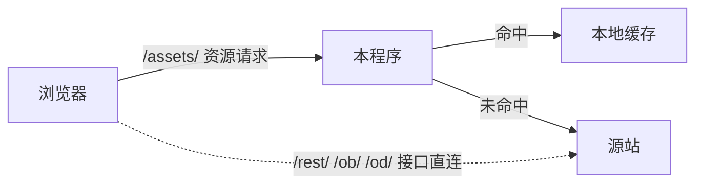

<div align="center">

# 碧蓝幻想本地缓存程序

**将游戏资源缓存至本地告别反复下载资源** —— 
在碧蓝幻想游玩过程中将图片、声音、文字脚本等游戏资源存储，后续直接读取本地资源提高加载速度 —— 游玩更顺畅、更省流。

`V4.20.4`<!--version--> · Windows 10 / 11 x64 · 零 npm 依赖 · 单文件 exe

[下载最新版](../../releases/latest) ·
[介绍与免责声明](介绍与免责声明.md) ·

</div>

---

## 这是什么

一个 Windows 端的本地 HTTPS 缓存器。它只在**游戏和网络之间**多问一句：
「这份资源，你电脑里已经有了吗？」

- 有 → 直接从硬盘读出来返回
- 没有 → 储存资源至本地，下次就有了。

它不需要游戏官方配合，也不修改游戏本身。程序本身**不包含任何游戏资料**，
你电脑里存下的内容只存在于你自己的电脑上。

**适合谁：** 想让游戏打开、切换更顺的玩家；想省流量的人；

## 它怎么工作



1. **接管**：程序把一段 PAC 写进系统「自动配置脚本」槽位，只对游戏的 `/assets/` 路径回 `PROXY 127.0.0.1:8899`，
   其余流量照常直连。
2. **解密**：用随包的自签根证书在本机做 TLS 终结 —— 请求的域名和协议完全不变，
   所以 CORS、Cookie、Referer 一切照旧。
3. **命中判定**（三样全对才算命中，缺一不可）：
   - 缓存文件在（磁盘上按 URL 路径原样镜像，旁边一份 `.ext` 元数据）；
   - **查询串一致**：游戏用 `?1729002592` 这类参数标记资源版本，`.ext` 的 `q` 字段记着当初是从哪个查询串写下来的；
   - **CORS 头跟着文件一起存**：命中时原样回给浏览器，否则带 `crossorigin` 的脚本会被浏览器拒绝执行。
4. **落盘**：回源成功后原子写（先写临时文件再改名），同一资源的并发请求合并成一次回源。
5. **可见**：命中 / 回源 / 新写入 / 异常拦截 / 错误五个计数实时推到控制台与桌面悬浮条。

### 几条刻意的红线

| 红线 | 为什么 |
|---|---|
| 只接管 `/assets/` 下的 GET/HEAD | 其余请求原样转发，绝不做缓存 |
| `/rest/` `/ob/` `/od/` 必须直连，`/user/` 绝不拦截 | **凡是需要 Cookie 才能正确返回的请求，都不能走本地缓存代理**（浏览器不会把游戏的 Cookie 发到本机代理，走缓存必然出错） |
| 版本不匹配的文件绝不当命中 | 否则游戏会判定「新しいバージョンがあります」并反复整页重载 |
| 退出必须走托盘菜单的「退出」 | 优雅退出才会把系统里的上网设置还原回去 |

## 下载与安装

**发行版（推荐）**：到 [Releases](../../releases/latest) 下载 `GBFCache-Setup-V*.exe`（安装包）或
`GBF-Cache-EXE-V*.zip`（免安装），解压后看随包的 `安装与使用说明.txt`。

三步上手：

1. **解压**到固定文件夹（别只把 exe 单独拿走，旁边那几个文件是配套的）；
2. **装一次随包的证书** `certs\ca.crt`：双击 → 安装证书 → 「当前用户」→「受信任的根证书颁发机构」。
   不需要管理员权限；装完请把浏览器**完全关掉再打开**；
3. **双击 `GBFCache.exe`**，右下角出现托盘图标，控制台里点「启动游戏」。

判断它在工作最简单的一招：**看「缓存命中」在不在涨**。


## 本仓库结构

```
├─ plugin/                   源码（开发版 = 运行时目录）
│  ├─ server.js              主程序 —— 零 npm 依赖，只用 Node 内置模块
│  │                         （文件顶部的 const VERSION 是版本号唯一来源）
│  ├─ tray.ps1               托盘启动器：单实例、托盘菜单、控制台窗口、悬浮监控条
│  ├─ dashboard.html         控制台界面（单文件 HTML，原生 JS，无框架，深/浅双主题）
│  ├─ certs/                 本地 TLS 终结用的证书（ca.crt + server.crt/key）
│  ├─ edge-extension/        可选的浏览器扩展（另一种接管方式）
│  └─ start-server.bat       直接起服务（需要系统里有 Node）
├─ docs/                     GitHub Pages 站点：原理动画 + 缓存布局交互解释
│  └─ assets/version.js      由脚本生成，勿手改
├─ scripts/
│  └─ sync-site-version.js   把站点的版本号同步成 server.js 里的那一个
└─ 介绍与免责声明.md          给准备使用本程序的人看的说明
```

> **没有放进仓库的东西**（刻意的）：`ca.key`（中间人 CA 的私钥，绝不外发）、
> `config.json`（含本机路径）、游戏缓存与日志、构建产物（exe / 安装包 / zip）、
> 内部交接与排障文档、打包用的构建管线。
> 这些由仓库根目录的 `.gitignore` 以**白名单**方式挡在外面：只有明确列出的目录与文件才会进版本库。

### 改完程序后

```bash
node scripts/sync-site-version.js           # 站点上的版本徽标跟随 server.js
node scripts/sync-site-version.js --check   # 只校验（不一致则退出码 1）
```

## 免责声明（摘要）

1. **非官方**：本程序是个人制作的第三方工具，与游戏开发 / 运营方（Cygames）及《碧蓝幻想》官方**没有任何关系**。
2. **不含游戏内容**：程序本身不含任何游戏资料；你电脑里存下来的内容只存在于你自己的电脑上。
3. **仅供个人使用**：请只用于你自己的电脑与账号。**请勿**把存下来的游戏资料上传、分享或以任何形式公开传播 —— 那些内容属于游戏公司。
4. **风险自负**：程序按「现状」提供，使用中可能出现的问题由使用者自行承担。
5. **请遵守规则**：请遵守游戏服务条款与当地法律；若官方明确表示不允许这类做法，请立即停止使用并删除本程序。

完整版见 [介绍与免责声明.md](介绍与免责声明.md)。

## 许可

本仓库暂未附加开源许可证（默认保留所有权利）。若需要以本仓库之外的方式使用，请先联系作者。

---

<sub>本页面与程序均为个人作品，与 Cygames 及《碧蓝幻想》官方无任何关系。</sub>
